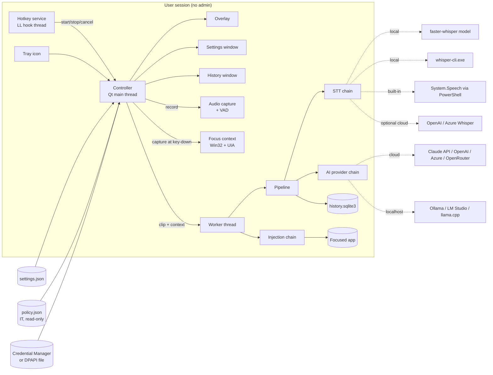
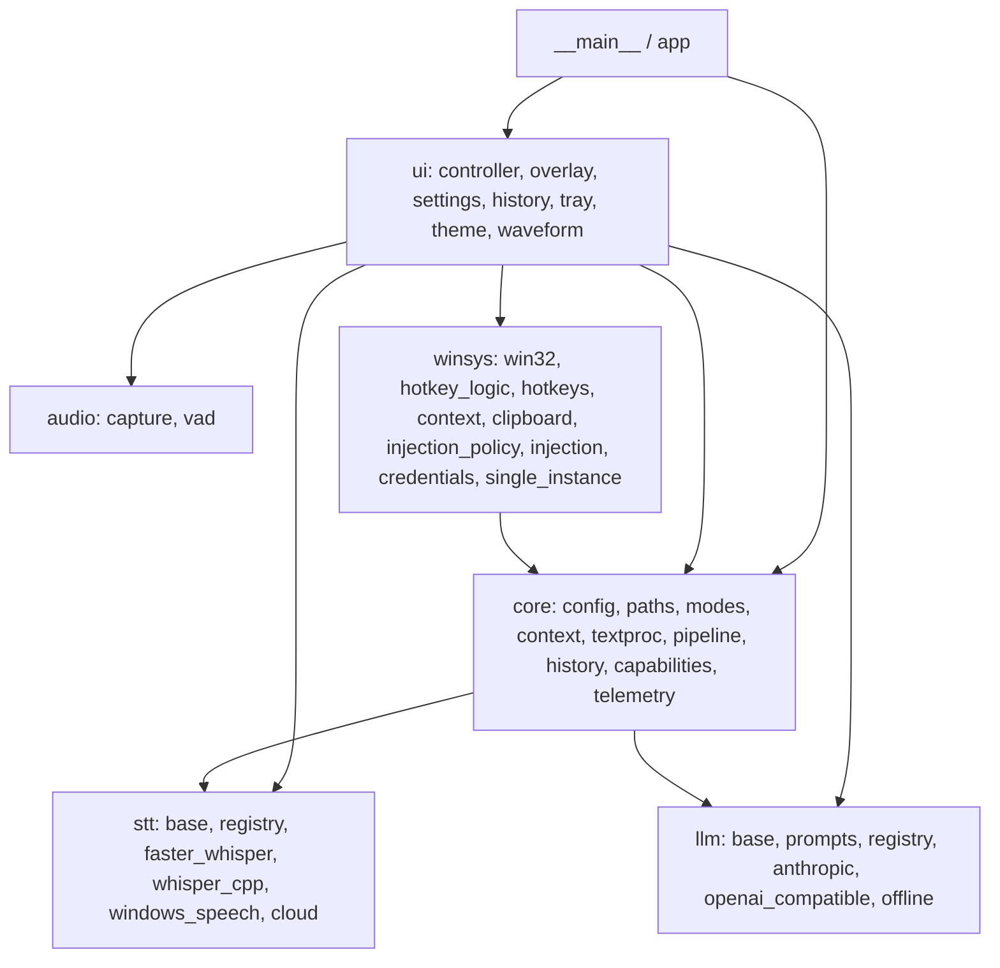
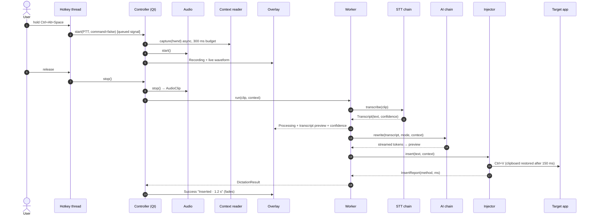
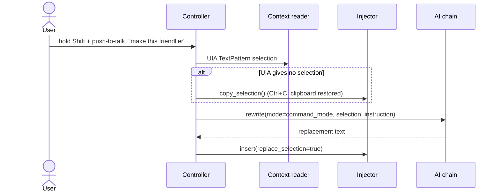
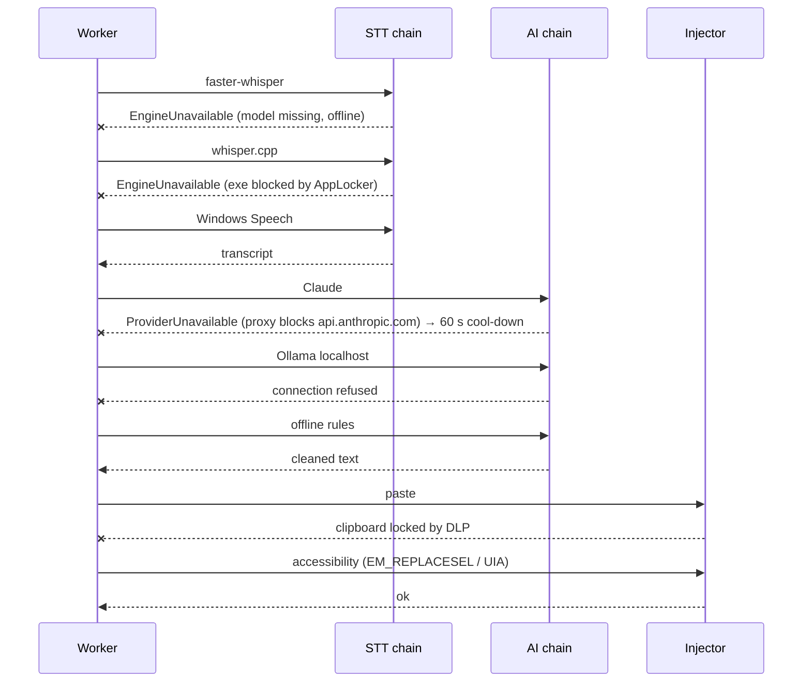
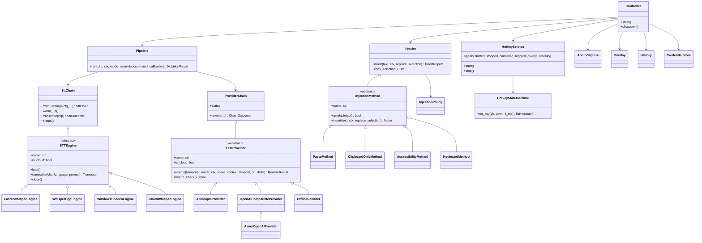

# Sayso architecture

Sayso turns speech into finished text in whatever Windows app has focus:

```
Voice → capture + VAD → STT engine chain → AI rewrite chain → injection method chain → focused app
```

It is a single per-user process (no service, no driver, no admin), started from a portable folder, a single
exe, or a per-user install. Every layer is a chain of interchangeable plugins with a guaranteed last resort,
so a restriction removes quality, never the ability to dictate.

| Layer | Primary | Fallbacks | Always-works floor |
|---|---|---|---|
| Hotkeys | Low-level keyboard hook (hold, toggle, double-tap) | `RegisterHotKey` (toggle only) | Tray menu "Start dictation" |
| Audio | `sounddevice` (WASAPI shared) | MME device | Clear error with the Windows privacy setting to change |
| STT | faster-whisper (local) | whisper.cpp CLI/server, Windows Speech (System.Speech) | cloud Whisper if allowed |
| AI | Configured chain (default: Claude → Ollama) | Any of OpenAI, Azure OpenAI, OpenRouter, LM Studio, local server | Offline rule-based rewriter |
| Injection | Simulated paste with clipboard restore | Accessibility (EM_REPLACESEL / UIA), keyboard simulation | Clipboard replacement + "press Ctrl+V" toast |

## 1. System architecture



## 2. Components and dependencies

Arrows mean "imports". `core`, `stt` and `llm` never import Qt or Windows APIs, so they are unit-tested on any
OS. `winsys` is the only package that calls Win32. `ui` is the only package that imports Qt, with one declared exception: `winsys/hotkeys.py` is a `QObject` so it can emit signals from its hook thread (`tests/test_layering.py` encodes this). `runtime_probes.py` and `app.py` sit above the layers and wire real Windows probes into `core.capabilities`.



## 3. Sequence: push-to-talk dictation



## 4. Sequence: command mode (edit the selection by voice)



## 5. Sequence: enterprise degradation



## 6. Class diagram



## 7. Threads

| Thread | Owns | Rule |
|---|---|---|
| Qt main | UI, Controller, signals | Never blocks on I/O |
| Hotkey | `SetWindowsHookEx` + `GetMessage` loop | Callback returns in < 1 ms; only runs the state machine and posts Qt signals |
| Audio | PortAudio callback | Copies frames into a ring buffer, computes level, runs VAD; nothing else |
| Worker (1, `ThreadPoolExecutor(max_workers=1)`) | STT, AI, injection | One dictation at a time, serialised |
| Warm-up (startup) | Model load, provider health checks | Never delays the tray appearing |

## 8. Data and file locations

| Item | Installed / single exe | Portable (`portable` file next to exe) |
|---|---|---|
| Settings | `%APPDATA%\Sayso\settings.json` | `.\data\config\settings.json` |
| Policy (IT, read-only) | `.\policy.json` next to exe, else `%PROGRAMDATA%\Sayso\policy.json` | same |
| Models | `%LOCALAPPDATA%\Sayso\models` | `.\data\models` (or `.\models` bundled) |
| History | `%LOCALAPPDATA%\Sayso\history.sqlite3` | `.\data\history.sqlite3` |
| Logs (no dictated text) | `%LOCALAPPDATA%\Sayso\logs\sayso.log` | `.\data\logs\sayso.log` |
| Secrets | Windows Credential Manager (`Sayso/<ref>`) | DPAPI file `.\data\secrets.bin` (user+machine bound) |

## 9. Plugins

STT engines and AI providers register through Python entry points, so a separate wheel can add one without
changing Sayso:

```toml
[project.entry-points."sayso.stt"]
azure_speech = "sayso_azure_speech:create"   # create(stt_settings, models_dir, secrets) -> STTEngine

[project.entry-points."sayso.llm"]
bedrock = "sayso_bedrock:BedrockProvider"     # BedrockProvider(name, provider_settings, api_key) -> LLMProvider
```

A plugin name is then used in `stt.engines` or as a provider `kind`. Frozen builds include only the plugins
listed in `packaging/pyinstaller/sayso.spec` `hiddenimports`.
